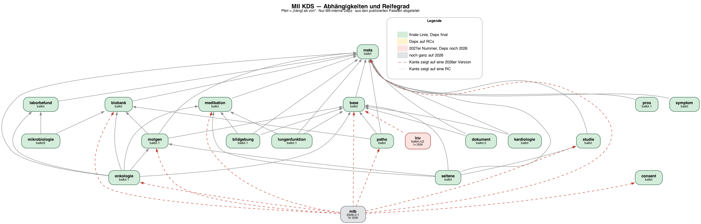

# Reifegrad der KDS-Module

BOM `2027.0.0-ballot.19` · 21 Module · automatisch erzeugt von `scripts/build-status.py`

Der Reifegrad misst **Version und Abhängigkeiten zusammen**. Eine 2027er Versionsnummer allein sagt wenig — entscheidend ist, worauf das Paket intern zeigt.

| Stufe | Module |
|---|---|
| **finale Linie** | base, bildgebung, biobank, consent, dokument, icu, kardiologie, laborbefund, lungenfunktion, medikation, meta, mikrobiologie, molgen, mtb, onkologie, patho, pros, seltene, soziodemographie, studie, symptom |

**0 offene 2026er Referenzen** über alle Module.

## Publikationsweg

Abgelesen am gepinnten Paket selbst: Der IG Publisher schreibt `.index.json` mit `index-version` 2 und `tools-version: 3` in `package.json`, ein von Simplifier gebautes Paket hat beides nicht. Ob ein IG-Publisher-Paket über einen Feed in die FHIR-Registry kommt, zeigt `package-feeds.json` in `FHIR/ig-registry`. Simplifier-Bake-Module brauchen `fsh-generated/` im Repo, weil Simplifier daraus baut.

| Weg | Module |
|---|---|
| **IG Publisher, Feed in der FHIR-Registry** | base, soziodemographie |
| **IG Publisher, Paket nach Simplifier hochgeladen** | biobank, consent, dokument, icu, medikation, meta, molgen, mtb, onkologie, seltene, studie, symptom |
| **Simplifier baut das Paket (Bake)** | bildgebung, kardiologie, laborbefund, lungenfunktion, mikrobiologie, patho, pros |

## Je Modul

| Modul | Version | Publikation | Deps | offen auf 2026 | auf RCs |
|---|---|---|---|---|---|
| base | `2027.0.0-ballot` | IG Publisher, Feed in der FHIR-Registry | 1 | — | — |
| bildgebung | `2027.0.0-ballot.1` | Simplifier baut das Paket (Bake) | 3 | — | — |
| biobank | `2027.0.0-ballot` | IG Publisher, Paket nach Simplifier hochgeladen | 1 | — | — |
| consent | `2027.0.0-ballot` | IG Publisher, Paket nach Simplifier hochgeladen | 0 | — | — |
| dokument | `2027.0.0-ballot.2` | IG Publisher, Paket nach Simplifier hochgeladen | 2 | — | — |
| icu | `2027.0.0-ballot.3` | IG Publisher, Paket nach Simplifier hochgeladen | 2 | — | — |
| kardiologie | `2027.0.0-ballot` | Simplifier baut das Paket (Bake) | 2 | — | — |
| laborbefund | `2027.0.0-ballot` | Simplifier baut das Paket (Bake) | 1 | — | — |
| lungenfunktion | `2027.0.0-ballot.1` | Simplifier baut das Paket (Bake) | 3 | — | — |
| medikation | `2027.0.0-ballot` | IG Publisher, Paket nach Simplifier hochgeladen | 1 | — | — |
| meta | `2027.0.0-ballot` | IG Publisher, Paket nach Simplifier hochgeladen | 0 | — | — |
| mikrobiologie | `2027.0.0-ballot2` | Simplifier baut das Paket (Bake) | 2 | — | — |
| molgen | `2027.0.0-ballot.1` | IG Publisher, Paket nach Simplifier hochgeladen | 3 | — | — |
| mtb | `2027.0.0-ballot.1` | IG Publisher, Paket nach Simplifier hochgeladen | 8 | — | — |
| onkologie | `2027.0.0-ballot.1` | IG Publisher, Paket nach Simplifier hochgeladen | 6 | — | — |
| patho | `2027.0.0-ballot` | Simplifier baut das Paket (Bake) | 3 | — | — |
| pros | `2027.0.0-ballot.1` | Simplifier baut das Paket (Bake) | 1 | — | — |
| seltene | `2027.0.0-ballot` | IG Publisher, Paket nach Simplifier hochgeladen | 5 | — | — |
| soziodemographie | `2027.0.0-ballot` | IG Publisher, Feed in der FHIR-Registry | 2 | — | — |
| studie | `2027.0.0-ballot` | IG Publisher, Paket nach Simplifier hochgeladen | 1 | — | — |
| symptom | `2027.0.0-ballot` | IG Publisher, Paket nach Simplifier hochgeladen | 1 | — | — |

## Graph



Quelle: `dependency-graph.dot`. Neu rendern mit

```bash
./scripts/build-status.py
```
